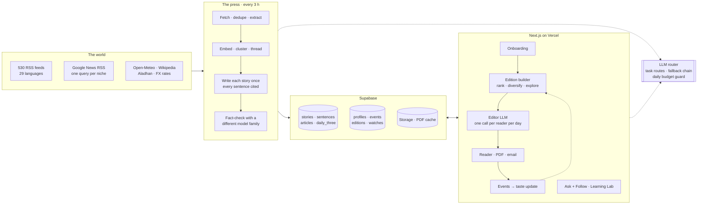
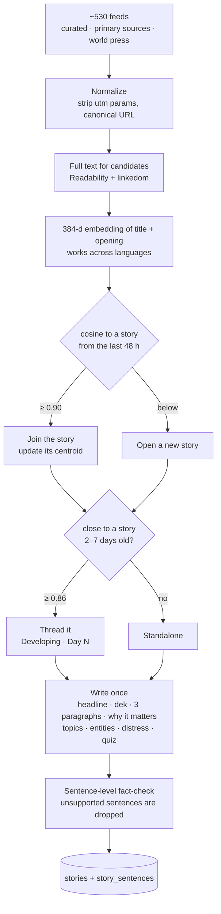
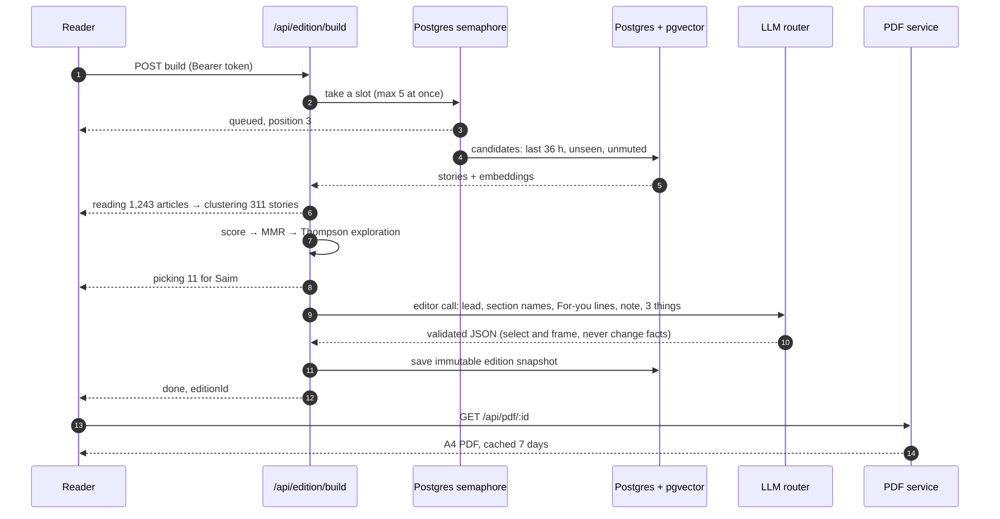
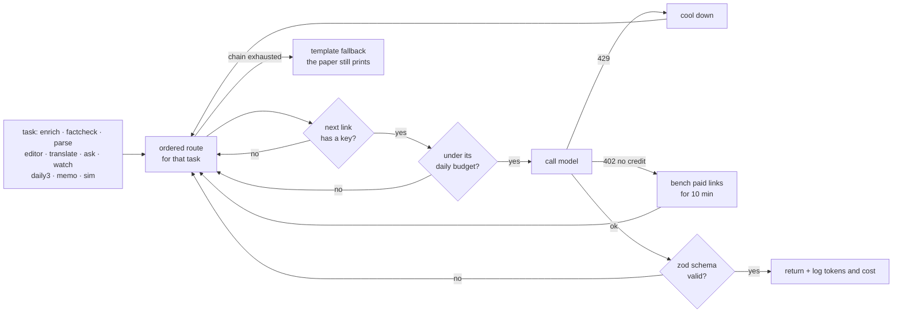
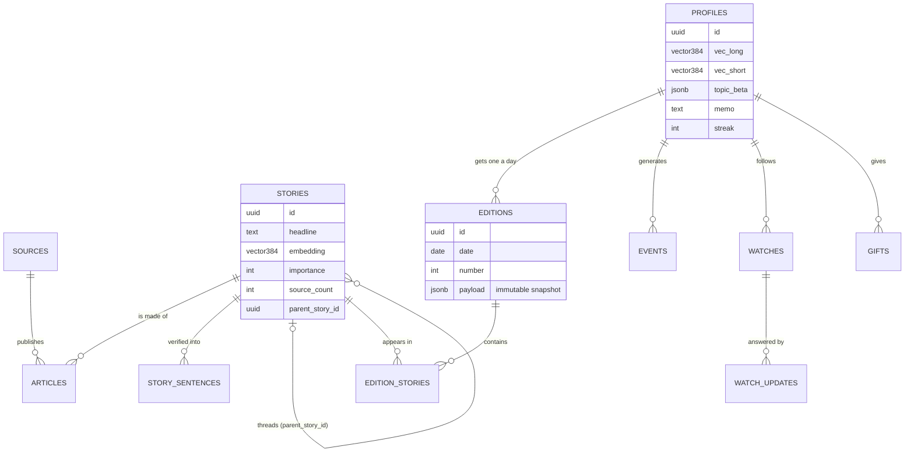

<div align="center">

```
╔══════════════════════════════════════════════════════════════╗
║                                                              ║
║                      E n d p a p e r                         ║
║                                                              ║
║   Vol. I  ·  No. 13  ·  Saturday, 17 October 2026           ║
║   Eleven stories · six minutes · one developing              ║
║                                                              ║
╚══════════════════════════════════════════════════════════════╝
```

### The morning paper that ends.

A personal daily newspaper for people who gave up on the news.<br/>
Short, sourced, written for one reader, and finished by 7:10 AM.

[**Live app**](https://endpage-nascon.vercel.app) &nbsp;·&nbsp; [Architecture](#architecture) &nbsp;·&nbsp; [How it learns](#how-it-learns) &nbsp;·&nbsp; [Run it](#run-it-locally) &nbsp;·&nbsp; [Docs](docs/)

Built for the NaSCon'26 AI Hackathon, Eynvision track: *build a personal morning paper.*

</div>

---

## The problem behind the problem

The brief says news is scattered. True, but a reader who finds everything in one place still has the other half of the complaint left over: they "click through link after link and still can't name three things they learned."

Scatter is the surface. The Reuters Institute's 2025 Digital News Report has about four in ten people in 48 countries sometimes or often avoiding the news, up from 29% in 2017. Avoiders say it wears them out and drags their mood down. Piling everything into one infinite feed, the Instagram answer, is how we got here. Artifact, built by Instagram's founders as a "TikTok for news," shut down in 2024.

So we built the opposite of a feed.

- **It ends.** Around ten stories, then *You're all caught up.* No scroll below the last page.
- **It is written for one person.** Every story carries a line on what it means for *you*, and only when there is a real link. No filler.
- **You can check it.** Every sentence points at the articles it came from. A second model from a different family checks each one, and we drop what it can't verify.
- **You keep something.** Three things you learned, a short quiz, a streak. The paper is judged on whether you remember it tomorrow.

## What you get

| The brief asks for | What's here | Where |
|---|---|---|
| **Onboarding** | 90 seconds. Name your paper, describe your mornings in a sentence or out loud, then swipe 12 real headlines picked to spread across your interests. A live front page assembles beside you as you answer. | [`src/components/onboarding`](src/components/onboarding), [`src/lib/deck.ts`](src/lib/deck.ts) |
| **The PDF** | A4 newspaper, typeset from the same edition as the web page: columns, hyphenation, a QR code beside every story, space given in proportion to your interest. Rendered by headless Chromium, cached for a week. | [`src/pdf`](src/pdf), [`src/components/print`](src/components/print) |
| **The web paper** | Two modes over one edition: a desktop broadsheet and a thumb-driven Stories mode for phones. Each story opens a side drawer with sources, "why you're seeing this", and click-through to the original. | [`src/components/reader`](src/components/reader) |
| **Past papers** | Every edition is an immutable snapshot. The archive is a shelf of front pages, each with its own PDF. | [`src/components/archive`](src/components/archive) |
| **Learning** | Reading signals move two taste vectors and a per-topic Beta distribution. A Learning Lab simulates readers and plots the result. | [`src/learning`](src/learning), [`src/lab`](src/lab) |
| **Room to explore** | Ask the news, gift papers in Urdu large print, a source scout that grows the catalog, the Daily 3 quiz, Calm mode. See [Beyond the brief](#beyond-the-brief). | below |

## Architecture

One Next.js app, one batch worker, one Postgres. The line that matters is between work done **once for everybody** (reading, clustering, writing each story) and work done **per reader** (vector math, plus a single editor call a day).



**Decisions worth defending**

- **Enrich once, personalize many.** A story is read and written one time. A reader's marginal cost is cosine similarity in Postgres and one small LLM call. In our logs a story write-up costs about $0.0013.
- **Embeddings only in the worker.** The web app never runs a model to make vectors. A new reader's starting profile comes from the stories they swiped, which are already embedded.
- **Nothing the LLM does is on the critical path of printing.** If every provider is down, the paper still builds from ranking, stored verified briefs and template copy (`meta.fallback = true`).
- **No microservices, no queue service.** Concurrency is a Postgres semaphore that lets five builds run at once. The rest see their place in line, and that wait *is* the printing-press animation.

## The press

Every three hours a GitHub Actions job turns a few thousand articles into a few hundred stories.



Details that took real work:

- **The clustering threshold is empirical.** e5 similarities sit in a compressed band: headlines about the same event score 0.85 to 0.94, unrelated news reaches 0.89. We tuned on 1,500 real articles ([`scripts/tune-cluster.mts`](scripts/tune-cluster.mts)). At 0.86 everything snowballed into a 500-article blob. At 0.93 real events split in half. We ship 0.90.
- **Cross-language clustering is free.** Coverage of one event in Urdu, Arabic and English lands in the same story, which is what powers "how the world covered it."
- **Primary sources sit next to the coverage.** Regulators, central banks, courts, company blogs and arXiv are in the catalog, so you can read the statement and the reaction together.
- **Number guard.** A figure in a written sentence has to appear in the sources it cites, or the sentence goes.

### The source catalog grows itself

When a reader types a niche that fits none of our topics ("Formula E," "Kenyan fintech"), the **source scout** runs. It searches Google News for the beat, collects the outlets covering it, finds their RSS feeds, checks that the feeds are alive and recent, has a model vet them, and adds them to the catalog for everybody. In a live run on "formula e" it found 32 outlets and added 5 sources in 55 seconds. Each reader's odd interest makes the paper better for the next person with the same one.

## How it learns

Two vectors and a set of coin-flip priors. No black box: the reader sees what was learned, how sure the editor is, and what moved since yesterday on `/me`.

```mermaid
flowchart LR
    subgraph signals["What the reader does"]
        s1["open · dwell > 20 s<br/>read to the end"]
        s2["more / less like this<br/>with a reason"]
        s3["skip · mute a topic or source"]
        s4["quiz answers · caught up"]
    end

    subgraph state["What we keep per reader"]
        vl["vec_long<br/>who you are<br/>η = 0.05"]
        vs["vec_short<br/>what you're into this week<br/>η = 0.30, decays daily"]
        tb["topic_beta<br/>Beta(α, β) per topic<br/>Thompson-sampled"]
        memo["plain-English memo<br/>your editor's note on you"]
    end

    rank["Score · diversify · explore<br/>tomorrow's paper"]

    signals -->|"server sets the weights,<br/>client values are ignored"| state
    state --> rank
    rank -->|"a paper is read"| signals
    nightly["Nightly job<br/>decay + rewrite memo"] -.-> state
```



**Choosing what goes in your paper** is plain code ([`src/edition/rank.ts`](src/edition/rank.ts)) with no LLM involved:

```
score = 0.35·similarity(you, story) + 0.32·topic affinity + 0.13·importance
      + 0.10·freshness + 0.10·outlet count + 0.05·local boost
```

Then maximal-marginal-relevance (λ = 0.7) so the lead isn't five versions of one story, then 10 to 15% of slots go to **Off Your Beat**: under-explored topics picked by Thompson sampling, clearly labeled. That section is both the anti-echo-chamber and a source of new signal. A topic you turn down several times gets demoted, not nudged, so a "less like this" shows up in the very next paper.

A small "readers like you finished this" boost comes from stories co-read by readers with similar vectors. That is the part that improves for everyone as more people read.

### Proof, not a promise

A judge can't wait a week to see a paper improve, so [`/lab`](src/components/lab) runs simulated readers with hidden interests through simulated days: build the paper, let the persona read it, feed the events back, build the next day.

On a real pool of 4,778 stories, 7 simulated days, 4 seeds:

| | Result |
|---|---|
| Endpaper vs. onboarding-only profile | **+18 to +19 points** of relevance |
| Endpaper vs. random | **+14 to +22 points** |
| Topic diversity | **0.79 to 0.83**, against a floor of 0.45 |

Two honest notes. The gain shows as a **gap that grows** (static profiles decay from 31% to about 15% while Endpaper holds near 30%), not as a line climbing to the sky. We also tried a "liked-story anchor" memory to make the line climb, saw no gain, and reverted it. And the reader is a keyword judge for now, three personas over days sliced from a ~48 hour pool, so treat it as a proof of mechanism and not a user study. On a synthetic world with a known answer, relevance goes from 0.57 to 0.93 while the static baseline stays flat.

## Building one paper

Opening your paper streams real progress over Server-Sent Events. The animation on screen is the actual pipeline, with real counts.



A typical build takes 5 to 10 seconds with no LLM and about 25 with one.

## The LLM layer

Every model call goes through one file, [`src/lib/llm.ts`](src/lib/llm.ts). Model IDs live in one other file, [`src/lib/models.ts`](src/lib/models.ts). Each task has its own ordered route, so bulk work goes to free tiers first and the few calls a reader actually sees go to the model with the best prose.



- **Different families check each other.** In our measured run, Claude Haiku wrote the stories and Gemini Flash-Lite checked them. A model grading its own homework is the weakest check there is.
- **Spend is capped.** Per-model daily limits, a paid ceiling (`LLM_PAID_DAILY_USD`, default $2.50), and prepaid OpenRouter credit as the last link so it can't overspend.
- **Scraped text is data.** Articles, questions and story text sit inside `<<<UNTRUSTED>>>` delimiters (look-alikes defused). Models return JSON only and have no tools, no browsing, and no view of other readers.

## Trust

- **Every sentence has a receipt.** Newspaper-style superscripts open the source. Stories read "Confirmed by N outlets" or "Single source," and developing ones carry a "what we don't know yet" line.
- **We measure it.** Grounding rate, the share of sentences that passed the fact-check, is stored on every press run and shown in the paper and on [`/newsroom`](src/components/newsroom). Measured on 144 stories written and checked for real: **85 to 88%**. We print the number and don't round it up.
- **The editor selects and frames, never changes facts.** No financial or medical advice in "For you" lines. No AI-generated news images, only real photos or type.
- **Your data is yours.** Row-level security on every table, column-level grants so a reader can't edit their own plan or streak, anonymous-first sign-in, JSON export and full delete from `/me`. Full list in [docs/SECURITY.md](docs/SECURITY.md), including the known limits.

## Beyond the brief

- **Ask the news.** Type a question. The answer comes only from stories the press has verified in the last 14 days, with citations. If the news hasn't covered it, it says so and offers to follow it. Following puts a **Since you asked** box at the top of your next paper when new stories change the answer.
- **A paper for someone you love.** Compose one for a parent in English or Urdu (right-to-left, Noto Nastaliq), large print, with *Compiled for Abbu by Saim* in the masthead. The recipient opens a link, no account. This is the product's growth loop: every gift is a second reader.
- **The Daily 3.** The same three questions for every reader, shared Wordle-style as a spoiler-free grid.
- **Calm mode.** Each story is rated for how distressing it is. Turn it on and graphic stories are filtered and hard news is framed constructively.
- **Send a story to a friend.** It lands in their next paper as "Saim thinks you'd like this." If they have no account, the link makes one.
- **Voice onboarding.** Say your mornings out loud in any language (Whisper large-v3-turbo), with Web Speech as a fallback.
- **Morning email.** An hourly job sends each reader's paper at their own delivery time (7:00 by default) in their time zone, with a one-click signed unsubscribe.
- **Backfill.** `pnpm backfill` builds one edition for each past day "as of 7:00 local," so a new account has an archive to open.

One cap on our own cleverness: there's no chat interface and no infinite anything.

## Data model

Twenty-one tables, fourteen migrations ([`supabase/migrations`](supabase/migrations)). The core of it:



## Run it locally

You need Node 20+, pnpm, a Supabase project, and at least one LLM key. With no keys the app still runs and prints editions from the fallback path.

```bash
pnpm install
```

Create `.env.local` with these names (values are yours):

```
NEXT_PUBLIC_SUPABASE_URL        NEXT_PUBLIC_SUPABASE_ANON_KEY     SUPABASE_SERVICE_ROLE_KEY
GROQ_API_KEY   MISTRAL_API_KEY   OPENROUTER_API_KEY   GEMINI_API_KEY      # any one is enough
GMAIL_USER     GMAIL_APP_PASSWORD   APP_URL                                  # email, optional
ADMIN_KEY      TURNSTILE_SECRET     SENTRY_DSN                               # ops, optional
```

Apply the migrations in `supabase/migrations/`, turn on **anonymous sign-ins** in Supabase Auth, then:

```bash
pnpm press        # read the feeds once, cluster, write, fact-check
pnpm dev          # http://localhost:3000
```

Useful commands:

| Command | What it does |
|---|---|
| `pnpm press --dry --sources=20` | small press run that writes nothing |
| `pnpm lab` | run the Learning Lab (`--judge=llm` for model readers) |
| `pnpm scout --beat="formula e"` | grow the catalog for one niche |
| `pnpm backfill --email=you@x.com --days=7` | give an account a week of past editions |
| `pnpm email --force --user=<id>` | send a paper now |
| `pnpm models:check` | confirm every configured model ID still exists |
| `pnpm load 30` | load test: 30 concurrent onboardings |
| `pnpm test` | 83 unit tests |
| `pnpm typecheck && pnpm lint` | before any merge |

Four workflows in [`.github/workflows`](.github/workflows) run the production loop: `press` (every 3 h), `nightly` (taste decay and memos), `email` (hourly), `scout` (on demand).

## Repository map

```
src/
├── app/
│   ├── (site)/        pages: landing, start, paper, archive, me, lab, newsroom, gift, pricing, trust
│   ├── api/           onboarding · edition/build · events · ask · follow · gifts · share · pdf · scout · lab
│   └── print/[id]/    the page Chromium turns into the PDF
├── press/             fetch · normalize · extract · embed · cluster · enrich · daily3
├── edition/           candidates · rank · editor · assemble · translate · backfill
├── learning/          taste vectors, Beta topics, nightly decay + memo
├── follow/            ask-the-news and the "since you asked" watcher
├── scout/             the source scout
├── lab/               personas and the simulation
├── pdf/               headless Chromium service, signed print tokens
├── email/             render + delivery
├── lib/               llm router · models · supabase · onboarding parse · taxonomy · vectors
├── types/             edition.ts + events.ts: the contract
└── components/        reader · onboarding · paper · print · lab · gift · archive · ui
worker/                press, nightly, email, scout, backfill entry points + source catalog (530 feeds)
supabase/migrations/   schema, RLS, indexes, functions
tests/                 83 tests: cluster, rank, learning, llm router, enrich, translate, follow, pdf, ...
scripts/               end-to-end checks, cluster tuning, load test, model probe
docs/                  strategy, technical deep dive, API, security, launch playbook
```

## Stack

| Layer | Choice |
|---|---|
| App | Next.js 16, React 19, TypeScript (strict), zod on every input and every model output |
| Data | Supabase: Postgres, pgvector (HNSW), auth, storage, row-level security |
| Press | tsx worker on GitHub Actions, `@huggingface/transformers` for `multilingual-e5-small`, Readability + linkedom, rss-parser |
| Models | Mistral Small, gpt-oss, Llama 3.1, Qwen3 and Whisper through Groq and Mistral; Claude Haiku and Gemini Flash-Lite through OpenRouter as the paid fallback |
| PDF | puppeteer-core with `@sparticuz/chromium-min`, QR codes per story |
| Front end | Tailwind 4, Motion and GSAP for the paper-unfold, Lenis for scroll. Newsprint `#F3EFE6`, ink `#141414`, one spot red. Blackletter masthead, Newsreader text |
| Ops | Vercel (Seoul region), Sentry hook, Cloudflare Turnstile, per-IP and per-reader rate limits |

## Known limits

We'd rather you read these here than find them.

- The grounding rate of 85 to 88% is real and not yet where we want it. The pool beyond the 144 stories we ran end to end falls back to verbatim source sentences until more model credit lands.
- Fallback classification (topic from the source feed) is noisy, and fallback leads can be dry.
- RSS has almost no history. A backfilled week is thin before about two days ago.
- The Learning Lab uses a keyword reader, three personas and a short pool. It shows the mechanism works, and it isn't evidence of long-term retention.
- Rate limits held in memory are per serverless instance. They slow abuse down, and the hard caps live in the database.
- The Plus and Teams plans are fake doors: we count clicks and the waitlist before building them.
- Supabase free tier is 500 MB. Article text pruning isn't built.

## How it was built

Over one hackathon day, with every commit on `main`, `core` and `web`.

Two Claude Code sessions worked in parallel git worktrees: one owned the backend and the other the front end. They met at a typed contract, [`src/types/edition.ts`](src/types/edition.ts) plus [`fixtures/edition.sample.json`](fixtures/edition.sample.json), written first. The front end built against the fixture until the real API existed, and neither side edited the other's folders. The rules each session read are in [`CLAUDE.md`](CLAUDE.md).

## Read more

| | |
|---|---|
| [docs/STRATEGY.md](docs/STRATEGY.md) | Who it's for, why now, the business, and what killed every personalized-news product before us |
| [docs/TECH.md](docs/TECH.md) | The AI step by step, the open-model stack, sourcing, evals |
| [docs/API.md](docs/API.md) | Every endpoint, the SSE build stream, the PDF contract |
| [docs/SECURITY.md](docs/SECURITY.md) | What protects readers, and where it stops |
| [docs/LAUNCH.md](docs/LAUNCH.md) | Cost per reader, scaling stages, launch checklist |
| [docs/BACKEND_STATUS.md](docs/BACKEND_STATUS.md) | What was measured and what is still unproven |

<div align="center">
<br/>

*Name three things you learned from the news yesterday.*<br/>
*Tomorrow you'll have an answer.*

</div>
