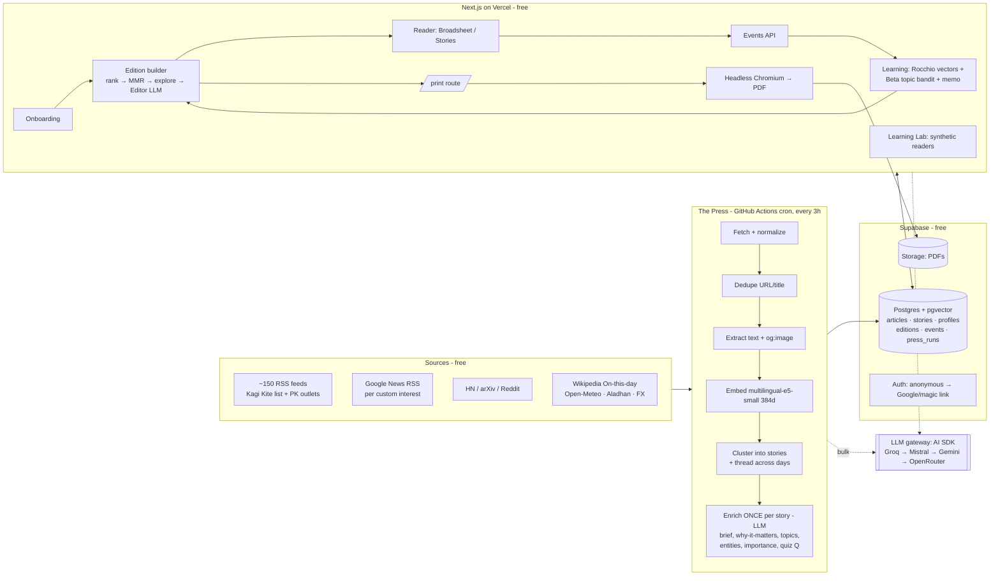

# FOLD — Battle Plan (NaSCon'26 AI Hackathon · Eynvision)

> Working name: **Fold** ("above the fold"): *the morning paper, folded for one.*
> Alternatives: **Inkling**, **Kaghaz** (Urdu for "paper", a local touch).
> Each reader's masthead is their own: **"The Saim Times — Islamabad Edition"**.

---

## 0. Read the room first

**Who is judging.** Eynvision is an applied-AI studio in Islamabad. They build AI-native SaaS for enterprises (copilots, voice agents, automation). Their site lists solutions named *Digest* and *Dispatch* and quotes "Real artists ship". These judges ship AI products for a living. They will reward:

1. A product that feels shipped: deployed URL, polished, no broken states.
2. AI used where it earns its place, with cost and reliability in mind. They will spot "GPT wrapper" in 10 seconds.
3. Evidence that it works, not claims. The brief says "the more the reader uses the product, the better the paper should become", so **prove** it.

**What they will actually see.** A 5-minute Loom, a GitHub repo where commits are monitored, and an architecture diagram. With 100 teams, the first 30 seconds of the Loom decide whether a judge leans in. The commit history decides whether they trust it.

**The hidden line in the brief.** *"…and still can't name three things they learned."* Most teams will solve "news is scattered" (aggregation). We also solve **"I can't remember what I read"**, the actual pain. That is our thesis.

---

## 1. What ~90 of the 100 teams will build (the baseline to beat)

| Area | Typical build | Why it loses |
|---|---|---|
| Onboarding | Checkbox grid: "Pick 3 topics: Tech / Sports / Business" | Boring, shallow signal, everyone has it |
| Sources | NewsAPI or GNews (NewsAPI free is dev-only and delayed) | One source, rate-limited, same articles for everyone |
| Unit | One article = one card | Five cards about the same event; feels like an RSS reader |
| AI | "Summarize this article with GPT" + a chat-with-news bot | Wrapper; no judgement, no memory |
| Learning | Like button increments a category counter | Invisible, unprovable |
| PDF | `html2pdf`/jsPDF screenshot of the web page, or a plain list | Not a newspaper |
| Design | Default shadcn dark dashboard, purple gradient, emoji icons | "AI slop" look |
| Demo | localhost, empty archive, rushed Loom | Not shipped |
| Repo | One giant commit at hour 11 | Looks pre-built or chaotic |

---

## 2. Our thesis (the pitch in four lines)

> **v2 (YC lens), see [STRATEGY.md](STRATEGY.md):** *Fold is the 6-minute morning paper for people who've given up on the news.*
> 4 in 10 people avoid the news (Reuters Institute 2025). We build for them: short, personal, **it ends**, a **"For you" line** on every story, and **recall** the next morning.
> **Wedge:** "Make one for someone you love": an Urdu, large-print paper for your parents. **Proof:** Learning Lab + real users on hackathon day.

> In 1995 Nicholas Negroponte imagined **"The Daily Me"**, a newspaper edited for one reader.
> In 2001 Cass Sunstein warned it would become an **echo chamber**.
> In 2024 Instagram's founders shut down **Artifact**, their "TikTok for news". Infinite feeds don't work for news.
> **Fold is the Daily Me done right: a paper that knows you, deliberately shows you one thing off your beat, ends when it's done, and makes sure you remember three things.**

Product principles:

1. **Stories, not articles.** Cluster 1,000+ articles into ~300 stories. Each story is written from multiple sources ("6 sources") and feels edited, not aggregated.
2. **A paper that ends.** It is finite by design, ending with "You're all caught up." This is the opposite of a feed and our ethical "addictive" angle: ritual, not doomscroll.
3. **Remember, don't just read.** "Three things you learned" plus a 3-question recall quiz the next morning (spaced repetition) and a streak.
4. **Visible, provable learning.** "Why you're seeing this" on every story, an editable "Reader DNA", and a **Learning Lab** where simulated readers prove relevance improves day over day.
5. **The paper remembers what you read.** For a developing story it says "Since you last read about this on Tuesday: …". No real newspaper can do this.
6. **Print-grade craft.** Real newspaper typesetting in the PDF: columns, justified and hyphenated text, drop caps, halftone photos, and a QR code beside every story linking to the original.

---

## 3. The product, screen by screen

### 3.1 Landing (10 seconds to "I want this")
- The hero is a live front page. As the visitor types their name, the masthead re-sets in blackletter: **"The ___ Times"**.
- CTA: **"Print my first paper: 90 seconds, no signup."**
- Below: "Three things you'll remember tomorrow" promise, a sample PDF front page, and how it learns.

### 3.2 Onboarding (90 seconds, 4 beats, live preview on the right)
A mini front page assembles itself on the side as the user answers. Every answer visibly changes "their" paper.

1. **Name your paper.** Name + city (geo-detected, editable). The masthead appears at once ("The Saim Times · Islamabad Edition · No. 1"). The IKEA effect starts here.
2. **"Tell me about your mornings."** One free-text box (plus mic button via the Web Speech API):
   *"CS grad, into AI startups, F1 and Pakistan's economy. Skip celebrity gossip."*
   The LLM parses it into interests, entities, negatives, region and depth, shown as **editable chips** (tap × to remove).
3. **Swipe today's front pages.** 12 real headlines from today's pool. Swipe right = interested, left = not, up = love.
   **Adaptive deck (AI depth):** the next card comes from *farthest-point sampling* over story embeddings, weighted by importance, so 12 swipes cover the user's interest space instead of 12 tech stories.
4. **How do you read?**
   - Edition size: *Espresso* (5 min) / *Standard* (12 min) / *Long read* (25 min)
   - Tone: *Straight* / *Explain like I'm new* / *Witty*
   - Delivery time: 7:00 AM
   - Extras: Weather · Prayer times · Markets/PKR · Cricket · On this day · Quiz · Audio

Then comes **"Printing your first edition…"**, a live stream of the *real* pipeline:
`Reading 1,243 articles from 142 sources → 311 stories → picking 14 for Saim → setting the front page → writing your editor's note`.
The paper "unfolds" (Motion animation). **Signup is deferred**: Supabase anonymous auth first, then "Save your paper & get tomorrow's at 7 AM" links Google or magic-link. Show value before asking for an email.

### 3.3 Reading: two modes, one edition
- **Desktop "Broadsheet":** a real newspaper grid. It has a masthead, ears (weather, edition number, date, "Price: your attention"), a lead story, section fronts, column rules, briefs and the editor's note. Click a story to open a side drawer with:
  - the multi-source brief, "Why it matters", "Why you're seeing this"
  - "Since you last read" for developing stories, and "Catch me up" background
  - source list with links ("Read original →"), plus actions: 👍 More · 👎 Less (with a 1-tap reason: *topic / source / too long / already knew*) · Save · Skip
- **Mobile "Morning Stories":** the brief name-checks Instagram, so give them its UX. Full-screen story cards with progress segments: tap = next, swipe up = read, swipe left = skip (a signal), double-tap = love.
- **The ending:** "You're all caught up." Then **3 things you learned today**, a 3-question quiz, the streak, and a **shareable card** (OG image of *your* front page) as the growth loop.

### 3.4 Archive
A shelf/calendar of past front pages (thumbnails). Clicking one opens the immutable snapshot of that day's edition, with a page-turn transition and a PDF download for each.

### 3.5 Reader DNA (`/me`)
- An interest map (bubble chart) of topics and entities with weights.
- **Editable memo:** an LLM-written paragraph such as "You follow AI policy more than AI products, skip cricket on weekdays, and read long-form on Saturdays." The user can edit it, and the edit feeds the editor.
- A learning timeline: "This week: + AI regulation, + Karachi, − Cricket".
- Followed stories, muted sources/topics.

### 3.6 Learning Lab (`/lab`), the judge-killer
- **Synthetic readers:** 3 LLM personas with *hidden* ground-truth interests (e.g. "Lahore fintech founder", "Islamabad med student into cricket", "Karachi designer into climate and culture").
- Simulate 7 days: each day the paper is built, the persona LLM reads it (open/skip/love/less-with-reason), events go into the learning loop, and the next day's paper is built.
- **Chart:** relevance@edition per day for Fold vs. "onboarding only" vs. "random", with a topic-diversity line that must stay above a floor (proves we are not an echo chamber).
- **Time-travel slider:** see Day 1 vs. Day 7 front page for the same persona.
- This doubles as the demo trick for the fact that judges can't wait a week to see learning.

### 3.7 Newsroom (`/newsroom`, ops page, 15 seconds in the video)
The last press run, articles in, stories formed, sources failed, LLM calls per provider, and fallbacks used. It signals engineering maturity.

### 3.8 The PDF (traditional newspaper, made fresh daily)
4 pages, A4:
- **Page A1 (front):** blackletter masthead "The Saim Times", ears (weather, edition No., date), lead story with halftone photo, 2–3 secondary stories, an "Inside" index box, and the editor's note.
- **A2–A3:** personalized sections. **Space is proportional to interest**: what you care about gets more column inches. Section names are personalized too ("Pit Lane" for F1, "The Startup Beat").
- **A4:** "In other news" briefs, **Off Your Beat** (the serendipity pick), On this day, the quiz with *answers printed upside-down* (classic newspaper touch), and "Tomorrow in your paper" for developing stories.
- Each story has a **QR code** to the original; links are also clickable in the PDF.
- Footer: `Page A2 · The Saim Times · Saturday, 17 October 2026 · No. 12`.

---

## 4. Architecture

Following the `system-architecture` skill: **one modular monolith + one batch job**. No microservices, no queues, no Kubernetes. Boundaries sit at real differences in change rate: *global ingestion* (every few hours, user-independent) vs. *per-user editions* (daily, personal) vs. *reading/learning* (real-time).



### 4.1 The key idea: **enrich once, personalize many**
- The expensive LLM work (reading and writing stories) happens **once per story**, shared by every reader.
- Personalization is mostly **vector math** (cheap and instant), plus **one** small "editor" LLM call per reader per day.
- Marginal cost per user is about 1 LLM call/day (~3K tokens). At paid rates that is roughly cents per user per month, and $0 on free tiers at hackathon scale. Put this in the pitch; an AI studio cares about unit economics.

### 4.2 Data model (Postgres + pgvector)
```
sources     (id, name, feed_url, kind[rss|gnews|hn|arxiv|reddit|scrape], category, region, status, last_ok_at)
articles    (id, source_id, url UNIQUE, title, excerpt, content_text, image_url, published_at,
             embedding vector(384), story_id)
stories     (id, headline, dek, brief text[], why_it_matters, category, topics text[], entities jsonb,
             importance int, embedding vector(384), source_count, first_seen_at, updated_at,
             parent_story_id  -- thread to earlier days ("developing")
             quiz jsonb)
profiles    (id, name, paper_name, city, lat, lon, tz, delivery_time, size, tone, extras jsonb,
             vec_long vector(384), vec_short vector(384), topic_beta jsonb {topic:[a,b]},
             muted jsonb, memo text, streak int)
editions    (id, user_id, date, number, payload jsonb  -- immutable Edition snapshot
             pdf_path, stats jsonb)
events      (id, user_id, edition_id, story_id, type, weight, meta jsonb, created_at)
press_runs  (id, started_at, finished_at, stats jsonb, errors jsonb)
```
HNSW index on `stories.embedding`. RLS so users only see their own profiles, editions and events.

### 4.3 The contract: write this FIRST (it unblocks parallel work)
```ts
// src/types/edition.ts
export type StorySlot = {
  storyId: string; size: 'lead' | 'major' | 'minor' | 'brief';
  kicker: string; headline: string; dek: string; body: string[];
  whyThis: string; whyItMatters: string;
  forYou?: string;                       // implication for THIS reader; omitted if no grounded link
  trust: { outlets: number; label: 'confirmed' | 'single-source' | 'developing'; unknowns?: string };
  distress: 0 | 1 | 2 | 3;               // for Calm mode
  sources: { name: string; url: string }[]; imageUrl?: string;
  developing?: { sinceLastRead: string; dayCount: number };
  topics: string[]; readMinutes: number;
};
export type Edition = {
  id: string; userId: string; date: string; number: number;
  paperName: string; city: string; tone: 'straight' | 'new' | 'witty';
  weather?: { hi: number; lo: number; summary: string };
  editorNote: string;
  lead: StorySlot;
  sections: { name: string; slots: StorySlot[] }[];
  offYourBeat: StorySlot[];             // serendipity / exploration
  briefs: StorySlot[];
  threeThings: string[];
  quiz: { q: string; options: string[]; answer: number; storyId: string }[];   // personal recall
  dailyThree: { q: string; options: string[]; answer: number; storyId: string }[]; // SAME for everyone today (Wordle-style)
  tomorrow: string[];                    // cliffhangers from developing stories
  everyonesFrontPage: StorySlot[];       // 1-2 shared top stories (common ground, anti-bubble)
  calm: boolean;
  gift?: { forName: string; fromName: string; relation: string; language: 'en' | 'ur'; largePrint: boolean };
  extras: { onThisDay?: string; prayer?: Record<string, string>; markets?: Record<string, string> };
};
```
Generate a realistic `fixtures/edition.sample.json` immediately so the UI and PDF tracks build against it while the pipeline is being written.

### 4.4 The Press pipeline (batch, GitHub Actions + runnable locally)
1. **Fetch** ~150 feeds in parallel (`p-limit(16)`, 8s timeout, per-source try/catch, status recorded). Add Google News RSS for each distinct custom interest across users: `https://news.google.com/rss/search?q=<q>+when:1d&hl=en-PK&gl=PK&ceid=PK:en`.
2. **Normalize/dedupe:** canonical URL (strip `utm_*`), unique constraint, near-duplicate titles via embeddings.
3. **Extract** full text only for candidates (`@mozilla/readability` + `linkedom`, or `@extractus/article-extractor`). Fall back to the RSS excerpt; paywalls are fine because we link out.
4. **Embed** title + excerpt with `multilingual-e5-small` (MIT, ~100 languages) via transformers.js **in the worker only**. Cross-language clustering then works (Urdu/Arabic/English coverage of one event = one story). The web app never embeds: new readers start from swiped-story vectors + precomputed topic vectors. *(Changed from gte-small; see TECH.md §2.)*
5. **Cluster:** nearest story in the last 48h (pgvector). If cosine > ~0.82 attach and update the centroid, else open a new story. **Threading:** if it matches a story from 2–7 days ago at > ~0.75, set `parent_story_id` and the story becomes "Developing · Day N".
6. **Enrich** (LLM, structured output via Zod, 4 stories per call) only for stories with fresh articles: neutral headline, dek, 3-paragraph multi-source brief, why-it-matters, category (fixed ~25-item taxonomy), topics, entities, importance 1–10, soft-news flag, one quiz question. Re-enrich when a story gains sources (feeds "since you last read").
7. Log a `press_runs` row.

### 4.5 Edition builder (per user, on demand + nightly)
1. **Candidates:** stories from the last 36h, not already shown (unless developing with an update), not muted.
2. **Score**
   `0.40·cos(user, story) + 0.20·topicAffinity + 0.15·importance + 0.10·freshness + 0.10·sourceCount + 0.05·localBoost`
   where `user = normalize(0.7·vec_long + 0.3·vec_short)`.
3. **Diversify** with MMR (λ≈0.7) so the lead isn't 5 versions of one topic.
4. **Explore:** about 10–15% of slots via **Thompson sampling** on under-explored topics. This becomes the labelled **"Off Your Beat"** section, the anti-echo-chamber feature and a learning signal.
5. **Editor LLM (1 call/user/day):** it gets the picked stories plus the reader memo and tone. It returns the lead choice, personalized section names and grouping, `whyThis` per story, the editor's note, three things and the quiz. It **never changes facts**: it only selects, arranges and frames.
6. Save the immutable snapshot, then render the PDF and cache it in Storage.

### 4.6 Learning loop (the "gets better" requirement)
| Signal | Weight |
|---|---|
| Open story | +1 |
| Dwell > 20s / read to end | +1.5 / +2.5 |
| Click original | +2 |
| Save | +3 |
| 👍 More like this | +4 |
| Skip (left swipe or < 2s in view) | −0.7 |
| 👎 Less like this (with reason) | −3 (reason routes it: topic, source, length, or "already knew") |
| Quiz answered | engagement signal + recall score |

- **Vectors (Rocchio-style, classic IR):** `vec_long` updates slowly (η≈0.05) and `vec_short` fast (η≈0.3, decays daily). This captures "I'm into the elections this week" without forgetting long-term interests.
- **Topic bandit:** `Beta(α,β)` per topic. Positives add to α, negatives to β, with a daily decay of 0.97. The mean drives affinity; Thompson samples drive exploration.
- **Memo:** nightly, an LLM rewrites a ≤80-word reader memo from a 7-day event summary plus the previous memo. The user can edit it, which keeps the model honest and explainable.
- **Cold start:** `vec = normalize(embed(sentence) + Σ swipe weights · story vectors)`, with topic priors from parsed chips.

### 4.7 Failure design (judges will ask)
- **LLM fallback chain** in `lib/llm.ts`: on 429/5xx/timeout try the next provider, and record which one served in `press_runs`.
- Every feed is isolated (timeouts, try/catch, status tracked); one dead source never kills a run.
- PDF: server Chromium; if that fails, fall back to client `window.print()` on the same `/print` route (identical design).
- Scraped content is **untrusted data**: strip HTML, structured outputs only, never follow instructions inside article text.
- Editions are immutable snapshots, so the archive never shifts.

### 4.8 Repo layout (group by domain)
```
src/
  app/
    page.tsx                 landing
    onboarding/              4-beat flow
    paper/[date]/            reader (broadsheet + stories)
    print/[editionId]/       print-only layout (PDF source)
    archive/  me/  lab/  newsroom/
    api/edition/route.ts     build on demand (streams progress)
    api/events/route.ts      signals
    api/pdf/[id]/route.ts    Chromium → PDF → Storage
    api/onboarding/parse/route.ts
  press/      sources.json fetch.ts extract.ts embed.ts cluster.ts enrich.ts run.ts
  edition/    rank.ts diversify.ts explore.ts editor.ts build.ts
  learning/   signals.ts update.ts memo.ts simulate.ts
  lib/        llm.ts embed.ts supabase.ts
  types/      edition.ts
supabase/migrations/
.github/workflows/  press.yml (every 3h)  editions.yml (daily 00:30 UTC = 5:30 PKT)
fixtures/edition.sample.json
```

---

## 5. Tech stack (all $0)

| Layer | Choice | Why |
|---|---|---|
| App | **Next.js (App Router) + TypeScript** | One language end to end; Claude Code is fastest here |
| UI | Tailwind v4 + shadcn/ui (heavily restyled) + **Motion** (gestures, unfold) + Vaul + Sonner | Speed without the default look |
| Fonts (OFL) | **Chomsky** or UnifrakturMaguntia (masthead), **Newsreader** (Google Font designed for news), Libre Franklin (kickers), Noto Nastaliq Urdu (if Urdu edition) | Newspaper identity |
| DB / Auth / Storage | **Supabase** (Postgres + pgvector, anonymous auth, Storage, Edge Functions) | One free service covers four needs; Supabase MCP is already connected here |
| Embeddings | **multilingual-e5-small (384d)** in the worker only | Free, no API key, works across languages |
| LLM | **Vercel AI SDK** + Zod structured outputs, provider chain (below) | Swap providers with one line; typed JSON |
| PDF | `/print` route + **puppeteer-core + @sparticuz/chromium-min** on Vercel; client print fallback | Real CSS typesetting: columns, `hyphens:auto`, justify |
| Batch | **GitHub Actions** cron (public repo = free minutes) | No timeouts; judges see it running in the repo |
| Hosting | **Vercel Hobby** (functions up to 300s) | Free, instant previews |
| Audio | **kokoro-js** (82M TTS in the browser, WebGPU/WASM) → Web Speech API fallback | Free, high quality, runs on device |
| Email (stretch) | Resend free tier | 7 AM "your paper is ready" trigger |
| Share cards | `@vercel/og` | Free OG images of your front page |

### 5.1 Can the AI be 100% free? Yes. Here is the evaluation.
Free tiers changed a lot in 2026 and third-party numbers conflict. **Check each console's quota page at H0.**

| Provider | Free limits (approx., verify) | Role | Verdict |
|---|---|---|---|
| **Groq** | ~30 RPM. ~1K req/day on 70B / gpt-oss-120b; 14.4K req/day on llama-3.1-8b. Daily *token* caps are the real limit | **Latency-critical:** onboarding parse, editor call, live stream | ✅ Primary for real-time. Blazing fast, no card |
| **Mistral La Plateforme (Experiment)** | ~1B tokens/month, ~1–2 req/s; phone verification; opts into data training (fine for public news) | **Bulk:** story enrichment in the press, persona sims | ✅ Primary for batch. Huge token budget; latency doesn't matter |
| **Google Gemini (AI Studio)** | Volatile: Flash ~20–1,500 req/day depending on model; Flash-Lite ~500–1,000 req/day; Pro off free tier | Fallback #1; long-context jobs | ⚠️ Good but unpredictable; never the only provider |
| **OpenRouter `:free`** | 20 RPM; 50 req/day (1,000 with a one-time $10 top-up) | Last-resort fallback | ⚠️ Free models rotate |
| **Cerebras** | Now reportedly trial credits + card | — | ❌ Skip unless you already have a key |
| **multilingual-e5-small** (local) | Free (CPU in the worker) | Embeddings | ✅ |
| **OpenRouter prepaid ($5)** | Pay per token, can't overspend | Last-resort fallback for every task | ✅ Insurance |
| **kokoro-js / Web Speech** | Free, on device | Audio edition, voice onboarding | ✅ |

**Budget math (hackathon day):** ~300 new stories/day ÷ 4 per call = ~75 Mistral calls. Editor calls = 1 per user (Groq). 3 personas × 7 days of simulation = ~21 reader calls plus editors. Total: comfortably free.
**Note:** Claude Max powers *Claude Code* (your build speed). It is not an API key for the product.

---

## 6. Open source to stand on (use as dependencies or data, don't fork)

Commits are monitored. **Forking a whole project looks pre-built.** Use OSS as libraries and data, credit it in the README, and write the product code live.

| Project | Use it for |
|---|---|
| **Kagi Kite** `kagisearch/kite-public` (`kite_feeds.json`, `core_feeds.py`) | Curated, categorized feed catalog. Seed `sources.json` from it (check the license, credit it) |
| **Horizon** `Thysrael/Horizon` (MIT, ~5.7k★) | Reference for source adapters (HN, Reddit, GDELT, Google News) and its scoring rubric (`docs/scoring.md`). Read, don't fork |
| `@mozilla/readability` + `linkedom` / `@extractus/article-extractor` / `rss-parser` | Extraction and feeds |
| `@huggingface/transformers` + `Xenova/multilingual-e5-small` | Local multilingual embeddings in the press |
| pgvector (HNSW) | Similarity, clustering, threading |
| Vercel AI SDK (`ai`, `@ai-sdk/groq`, `@ai-sdk/mistral`, `@ai-sdk/google`, OpenRouter provider) + `zod` | LLM gateway + typed outputs |
| `puppeteer-core` + `@sparticuz/chromium-min` (+ optional Paged.js) | PDF |
| `qrcode` | QR per story in print |
| `kokoro-js` | Audio edition |
| Motion, shadcn/ui, Vaul, Sonner, GSAP (free since 2025) | Interaction polish |
| Free data APIs: Open-Meteo (weather), Aladhan (prayer times), Wikimedia feed (On this day), HN Algolia, arXiv, GDELT DOC, Frankfurter (FX) | Ears and extras |
| **ScrapeGraph AI** (your `just-scrape` skill) | Optional "add any website" adapter for sites without RSS; also handy to verify feeds during the build |

**Sources are global by region** (from the Kite catalog), plus Google News editions per country and language. Add depth packs for the regions where we seed users first: South Asia (Dawn, Express Tribune, Geo, Business Recorder, ProPakistani, The Hindu, NDTV; verify URLs), US/UK and the Middle East. Ears adapt to the reader's city (weather everywhere; prayer times, markets and currency as optional extras).

---

## 7. Design direction (avoid the AI-slop look)
Use your `frontend-design` + `impeccable` skills for the build and polish pass.

- **Palette, "Morning newsprint":** paper `#F3EFE6`, ink `#141414`, hairline rules in ink at 85%, one spot color "press red" `#C8102E` used sparingly (masthead rule, LIVE/Developing badges).
- **"Evening Edition" dark theme:** `#121110` paper, `#EDE6D6` ink.
- **Type:** blackletter masthead; Newsreader for headlines and body (optical sizes); small-caps Libre Franklin kickers; tabular numerals in ears.
- **Images:** every photo gets the same **duotone/halftone** treatment so 14 random stock images look like one paper.
- **Motion:** paper unfolds on first load, ink-settle fade-ins, page-turn in the archive. Nothing bouncy.
- **Banned:** gradients, glassmorphism, emoji-as-icons, purple, generic card grids.
- **Microcopy:** a newspaper voice. "Stop the presses" (refresh), "Off your beat", "You're all caught up. See you at 7."

---

## 8. Scope tiers and cut lines

*(v2: re-prioritized with the YC lens, see STRATEGY.md §8)*

**MUST: core brief, done exceptionally**
- onboarding · press pipeline · edition builder · web reader (broadsheet + stories) · PDF · archive · learning loop + "why this"
- **"For you" line** per story (editor prompt + profile role/city/goals)
- **Trust badges** ("Confirmed by N outlets" / "Single source", "What we don't know yet")
- **Off Your Beat** + **Everyone's front page** (inside ranking)

**MUST: retention and proof (this is what makes it a product)**
1. Printing-press live stream (45 min)
2. All caught up → **3 things** → recall quiz → **streak** → **"Tomorrow in your paper"** cliffhanger (1 h)
3. **Daily 3** shared quiz + Wordle-style share grid + **WhatsApp share** via `wa.me` (45 min)
4. **7 AM email delivery** (Resend + GitHub Actions) + installable web app (45 min)
5. **PostHog funnel + one-question feedback**, then **ship to real users at H7.5** (30 min + distribution)
6. **Learning Lab:** synthetic readers + time travel (1–1.5 h)

**SHOULD: wedge and business**
7. **Gift a paper:** "Who's this for?" → large print → **Urdu** (Gemini for translation, Noto Nastaliq, right-to-left columns) → "Compiled for Abbu by Saim" (1.5 h; large-print English is the fallback)
8. **Calm mode** (20 min)
9. Pricing page + Fold+ fake door + Teams waitlist (20 min)
10. Developing stories, "since you last read" (45 min) · Reader DNA memo (30 min)

**STRETCH:** audio edition (kokoro-js) · Fold Wrapped card · "add any source" (RSS autodiscovery / ScrapeGraph) · newsletter inbox.

**Skip:** chat with the news (breaks the finite ritual; everyone will have it).

**Cut rules:**
- If the core loop (onboard → edition → read → PDF → archive) is not live on Vercel by **H6.5**, cut items 8–10 and all stretch.
- If behind at **H8.5**, Gift becomes "large-print English only".
- **Never cut:** real users, Learning Lab, retention items 2–4.

---

## 9. 12-hour schedule (H = hours from start)

Use **parallel Claude Code sessions in separate worktrees**. This is your real unfair advantage. The `Edition` contract + fixture is what makes parallel tracks possible.

| Time | Track | Deliverable |
|---|---|---|
| H0:00–0:30 | Setup | GitHub repo, Next.js scaffold, Supabase project + migration, API keys (Groq, Mistral, Gemini, OpenRouter), skeleton deployed to Vercel. **Commit.** |
| H0:30–1:00 | Contract | `types/edition.ts`, `fixtures/edition.sample.json`, `lib/llm.ts` fallback chain. **Commit.** |
| H1:00–3:30 | **A: Press** (session 1) | sources.json (Kite + PK), fetch/extract/embed/cluster/enrich, `press.yml`. 300+ real stories in the DB |
| H1:00–4:00 | **B: Reader UI** (session 2) | Design tokens, landing, Broadsheet, Stories mode, story drawer against the fixture. **Log reading events to `/api/events` from the first version** |
| H1:00–3:00 | **C: Print** (session 3) | `/print` layout, PDF route, QR codes, client-print fallback |
| H3:30–5:00 | Onboarding | 4 beats (+ "Who's this for? Me / Someone I love" fork), parse API, adaptive swipe deck, anonymous auth → link |
| H5:00–6:30 | Edition builder | rank → MMR → explore → editor LLM (**For you**, trust, tomorrow, Daily 3) → snapshot → PDF; archive page. **✅ CHECKPOINT: full loop live on Vercel** |
| H6:30–7:15 | Retention core | printing-press stream, all caught up → 3 things → quiz → streak, Daily 3 + share grid + WhatsApp, **masthead share card** |
| H7:15–8:00 | **Launch hardening** ([LAUNCH.md](LAUNCH.md) §1) | Google sign-in, edition job queue + AI-optional fallback, budget guard, rate limits + Turnstile, Sentry + PostHog + uptime, privacy/terms/delete-my-data, report-a-problem, `/newsroom` admin, 30-user load test |
| **H8:00** | **🚀 SHIP** | Soft launch to 5 friends → hackathon crowd → WhatsApp/LinkedIn. QR code on your laptop. **Start a parallel "launch desk" session** that watches errors and feedback and ships hotfixes until the end |
| H8:00–9:00 | Learning | Rocchio + Beta updates applied to the events logged since launch, why-this, memo, developing stories |
| H9:00–9:45 | Learning Lab | 2–3 personas, 5–7 day sim, chart, time travel; backfill 7 days of real editions for the demo account |
| H9:45–10:15 | Gift edition | "Who's this for?" flow, large-print template, one translated language (Urdu + Nastaliq) with others selectable, "Compiled for Abbu by Saim" |
| H10:15–10:45 | Polish + business | 7 AM email job (trigger once on camera), pricing page + Fold+ fake door + Teams waitlist, `impeccable` pass, **"v1.1 based on your feedback" post**, **screenshot the PostHog funnel** |
| H10:45–11:15 | Docs | README (problem → thesis → demo GIF → architecture diagram → AI design → Lab chart → $0 stack → run locally), polished diagram (Mermaid → Excalidraw/PNG) |
| H11:15–11:45 | Loom | Rehearse twice, record, ≤ 4:45 |
| H11:45–12:00 | Submit | Make the repo public, final commit, submit the form. Buffer. |

**Two-lane execution:** the per-lane timelines in [briefs/FRONTEND.md](briefs/FRONTEND.md) (Claude Code Desktop) and [briefs/BACKEND.md](briefs/BACKEND.md) (Claude Code CLI) supersede tracks A–C above. Same checkpoints: full loop live by **H6.5**, ship at **H8**, then a third "launch desk" session.

**Added since v2 (see TECH.md):**
- per-sentence citations + fact-check pass (MUST)
- primary sources in the catalog (MUST)
- "How the world covered it" via multilingual embeddings (SHOULD)
- source scout agent (SHOULD)
- send-to-a-friend's-paper + "readers like you" boost (SHOULD)

**Moved to stretch** to make room: Calm mode, Reader DNA memo UI.

**Commit hygiene:** commit every 30–45 min with clear messages (`feat(press): cluster articles into stories via pgvector`). Merge track branches visibly. Never commit `.env`. Let the GitHub Actions run history show the press working all day.

---

## 10. Loom script (≤ 4:45)

*(v2. The full spoken 60-second pitch is in STRATEGY.md §12.)*

| Time | Beat |
|---|---|
| 0:00–0:20 | **Hook.** "Name three things you learned from the news yesterday." **4 in 10 people avoid the news** (Reuters 2025). Artifact died. "Fold is the 6-minute morning paper for people who've given up on the news." |
| 0:20–1:05 | Onboarding live: name → masthead, one sentence → chips, 12 swipes, **printing-press stream**, the paper unfolds |
| 1:05–1:55 | Reading: **For you** lines, **Confirmed by 6 outlets**, why-this, developing; Calm-mode toggle; mobile Stories; **all caught up → 3 things → Daily 3 share grid → WhatsApp** |
| 1:55–2:20 | **PDF:** front page, **scan a QR code with your phone on camera** |
| 2:20–3:00 | **Learning:** swipe a "less" → why-this changes; **Learning Lab** chart (relevance climbs, diversity holds); Day 1 → Day 7 time travel |
| 3:00–3:30 | **Gift:** "I made one for my Abbu": Urdu, large print, "Compiled for Abbu by Saim". Flash 2–3 other languages (Spanish, Arabic, Hindi) to show it's for everyone |
| 3:30–4:00 | **Traction:** real users today: papers printed, % finished, shares, 1–2 quotes (PostHog screenshot) |
| 4:00–4:40 | Business + architecture: gift wedge → Fold+ → Teams; ~$0.001 per edition; enrich once / personalize many; $0 stack. Close on the live URL |

---

## 11. The SaaS story
**Superseded by [STRATEGY.md](STRATEGY.md) §9.** In short:
- Free → **Fold+** $4/mo (PKR 399) → **Fold Gift** $5/mo or $49/yr per recipient (**the wedge**) → **Teams** $8/seat.
- About $0.05 per user per month to serve.
- North star: **Finished Editions per week** + **Recall rate**.

---

## 12. Demo-day risk register
| Risk | Mitigation |
|---|---|
| Free LLM 429s mid-demo | Fallback chain; pre-generate demo editions; record the Loom from a warmed-up state |
| Chromium fails on Vercel | Client-print fallback; or pre-render daily PDFs in GitHub Actions with full Playwright |
| Feeds break or paywall | Per-source isolation; RSS excerpts; we link out anyway |
| Empty archive | Backfill 7 days from feeds' recent items (real past news, honestly dated) |
| Learning not visible in 5 min | Learning Lab + time-travel slider |
| Running out of time | Cut rule at H6.5; stretch items are independent and deletable |

---

## 13. Definition of done (check before recording)
- [ ] Live URL; a new user goes landing → paper in < 2 min with no errors
- [ ] Today's date on the masthead, real news, 6+ categories, Pakistani sources present
- [ ] Story drawer: multi-source brief, why-this, link out works
- [ ] Skip / More / Less change tomorrow's ranking (visible in Reader DNA)
- [ ] PDF downloads, looks like a newspaper, QR codes scan
- [ ] Archive shows 7 days
- [ ] Learning Lab chart renders with 3 personas + baselines
- [ ] Every story shows a trust badge; most show a grounded "For you" line
- [ ] All caught up → 3 things → Daily 3 → share grid opens WhatsApp with the text prefilled
- [ ] 7 AM email job runs (trigger it manually once on camera or in Actions)
- [ ] Gift paper PDF renders (Urdu or large-print English)
- [ ] Real users: the PostHog funnel has numbers; 1–2 quotes collected
- [ ] Mobile Stories mode works on a real phone
- [ ] README + architecture diagram + Loom ≤ 5 min; repo public
